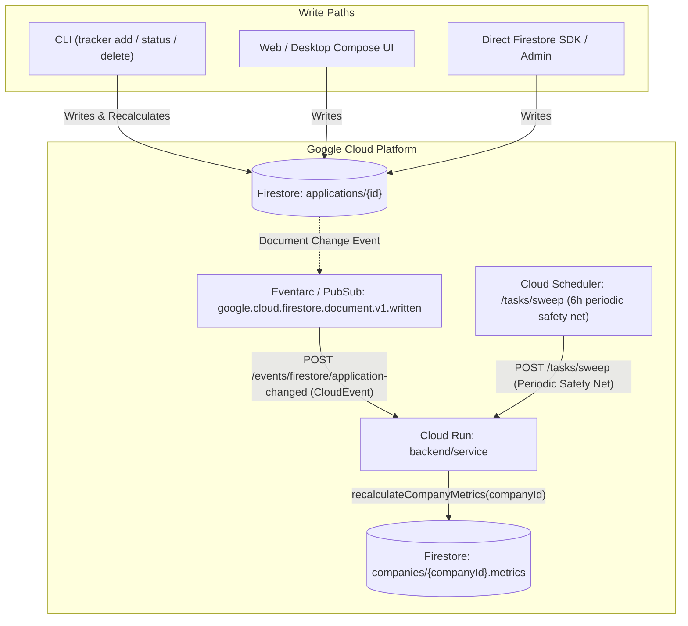

# Implementation Plan: Event-Driven Company Metrics Synchronization

**Status:** Completed  
**Date:** 2026-11-23  
**Target:** `backend` and `frontend` (cross-subsystem)  
**Harness:** Antigravity  
**Model:** gemini-2.5-pro  
**Session:** c3a5beb9-c626-4f40-bfe0-df9bfd9fead1  
**Schema Authority:** [`tracker.schema.json`](../../tracker.schema.json)  
**Depends On:** [`152251_fix-company-metrics-defect.md`](../2026-11-19/152251_fix-company-metrics-defect.md)  

---

## 1. Executive Summary & Goals

The Companies feature (`frontend/features/companies-list` and `frontend/features/company-details`) presents pre-aggregated metrics (total application counts, funnel status breakdown percentages, salary range, primary source channel, and average fit score) stored on Firestore `companies/{companyId}.metrics`.

These statistics frequently drift out of sync with actual applications because:

1. `tracker add` (`AddApplicationCommand`) and `tracker delete` (`DeleteApplicationCommand`) wrote/deleted application documents without recalculating company metrics.
2. Direct edits in Firestore, web/desktop UI mutations, or script runs bypass client-side recalculation.
3. The only background synchronization was the Cloud Scheduler 6-hour sweep (`POST /tasks/sweep`).

### Goals

- [ ] Wire real-time company metrics recalculation into client-side CLI write commands (`AddApplicationCommand.kt` and `DeleteApplicationCommand.kt`).
- [ ] Implement an event-driven CloudEvent webhook endpoint `POST /events/firestore/application-changed` in `backend/service` (Ktor) to handle Firestore change notifications.
- [ ] Parse Firestore CloudEvent payloads (`google.cloud.firestore.document.v1.written`) to extract `companyId` from both previous and new document states.
- [ ] Trigger targeted O(1) `BackendService.recalculateCompanyMetrics(targetCompanyId)` on document mutation.
- [ ] Register Eventarc / PubSub configuration to stream Firestore document updates to Cloud Run.
- [ ] Provide comprehensive automated tests for CloudEvent parsing and metric update delegation.

---

## 2. Architecture & Design Principles



### Event Payload Schema

GCP Eventarc delivers CloudEvents over HTTP with:

- Standard headers: `ce-type`, `ce-source`, `ce-id`, `ce-subject` (e.g. `documents/applications/{appId}`).
- JSON Body:

  ```json
  {
    "oldValue": {
      "name": "projects/.../databases/(default)/documents/applications/bjak--android-software-engineer",
      "fields": {
        "companyId": { "stringValue": "bjak" },
        "status": { "stringValue": "DRAFTED" }
      }
    },
    "value": {
      "name": "projects/.../databases/(default)/documents/applications/bjak--android-software-engineer",
      "fields": {
        "companyId": { "stringValue": "bjak" },
        "status": { "stringValue": "SUBMITTED" }
      }
    }
  }
  ```

The event handler extracts the unique `companyId` targets from both `oldValue` and `value` (in case `companyId` changed or the document was deleted) and triggers:

```kotlin
val targetCompanyIds = extractCompanyIds(cloudEventPayload)
for (companyId in targetCompanyIds) {
    BackendService.recalculateCompanyMetrics(companyId)
}
```

---

## 3. Proposed Changes & Implementation Steps

### Phase 1: Client-Side Immediate Recalculation (Completed & Validated)

- Update `AddApplicationCommand.kt` to invoke `BackendService.recalculateCompanyMetrics(companyId)` after saving application.
- Update `DeleteApplicationCommand.kt` to invoke `BackendService.recalculateCompanyMetrics(targetCompanyId)` after deleting application.

### Phase 2: CloudEvent Ingestion in `backend/service`

#### [NEW] `backend/service/src/main/kotlin/dev/fnc314/aijobtracker/backend/routes/EventarcRoutes.kt`

- Implements `public fun Route.eventarcRoutes()`
- Exposes `post("/events/firestore/application-changed")`
- Validates CloudEvent headers (`ce-type == google.cloud.firestore.document.v1.written` or fallback body structure)
- Extracts `companyId` from Firestore JSON fields (`value.fields.companyId.stringValue` or `name` slug)
- Invokes `BackendService.recalculateCompanyMetrics(companyId)`
- Returns HTTP 200 with result statistics

#### [MODIFY] `backend/service/src/main/kotlin/dev/fnc314/aijobtracker/backend/Main.kt`

- Mount `eventarcRoutes()` in the root Ktor routing block.

### Phase 3: Unit Testing & Verification

#### [NEW] `backend/service/src/test/kotlin/dev/fnc314/aijobtracker/backend/routes/EventarcRoutesTest.kt`

- Test CloudEvent parsing for document creation, update, and deletion.
- Verify invalid payloads return HTTP 400 Bad Request.
- Verify successful metric recalculation returns HTTP 200 OK.

---

## 4. Verification Plan & Testing Checklist

### Automated Tests

```bash
./gradlew :backend:service:test --tests "dev.fnc314.aijobtracker.backend.routes.EventarcRoutesTest"
./gradlew :frontend:apps-cli:compileKotlin
./gradlew :tests:konsist:jvmTest
```

### Manual Verification

1. Start local backend server:

   ```bash
   ./gradlew :backend:service:run
   ```

2. Send test CloudEvent payload:

   ```bash
   curl -X POST http://localhost:8080/events/firestore/application-changed \
     -H "Content-Type: application/json" \
     -H "ce-type: google.cloud.firestore.document.v1.written" \
     -d '{"value":{"fields":{"companyId":{"stringValue":"bjak"}}}}'
   ```

3. Confirm response returns `{"status":"SUCCESS","companiesUpdated":1}`.

---

## 5. Bookkeeping

- [x] Plan persisted at `.agents/plans/2026-11-23/213643_event-driven-company-metrics-sync.md` (kebab-case title)
- [x] Registry `README.md` row added / status synchronized
- [ ] Craft a single commit of all changed files
- [ ] Stage changed files and craft a commit message based on the name of this file
- [ ] User will push `git push origin main` manually
