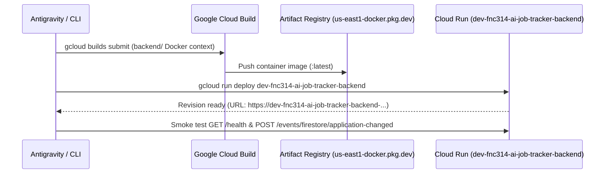

# Implementation Plan: Deploy Backend to Cloud Run

**Status:** Completed  
**Date:** 2026-11-23  
**Target:** `backend`  
**Harness:** Antigravity  
**Model:** gemini-2.5-pro  
**Session:** c3a5beb9-c626-4f40-bfe0-df9bfd9fead1  
**Schema Authority:** [`tracker.schema.json`](../../tracker.schema.json)  
**Depends On:** [`213643_event-driven-company-metrics-sync.md`](./213643_event-driven-company-metrics-sync.md)  

---

## 1. Executive Summary & Goals

Deploy the updated Kotlin Ktor backend service (`backend/service`) to Google Cloud Run (`dev-fnc314-ai-job-tracker-backend`) in region `us-east1` under GCP project `dev-fnc314-ai-job-tracker`.

The deployment includes the new Eventarc / CloudEvents receiver endpoint (`POST /events/firestore/application-changed`) and recent timeline / routine sweep enhancements.

### Goals

- [ ] Build the distribution package locally (`gradlew -p backend :service:installDist`).
- [ ] Submit container build to Google Cloud Build using `gcloud builds submit --tag <IMAGE_URI> backend` (or Docker if running).
- [ ] Deploy new revision to Cloud Run service `dev-fnc314-ai-job-tracker-backend` via `mise run remote:deploy:service --cloud`.
- [ ] Verify deployment health via `GET /health` and verify the new `POST /events/firestore/application-changed` endpoint.

---

## 2. Architecture & Design Principles



---

## 3. Proposed Changes & Implementation Steps

### Phase 1: Local Distribution Assembly

Run:

```bash
./gradlew -p backend :service:installDist
```

### Phase 2: Remote Cloud Run Deployment

Execute the canonical mise task with the `--cloud` flag (since local Docker daemon is not running):

```bash
mise run remote:deploy:service --cloud
```

This triggers:

1. `gcloud builds submit --tag us-east1-docker.pkg.dev/dev-fnc314-ai-job-tracker/dev-fnc314-ai-job-tracker-backend/backend:latest backend`
2. `gcloud run deploy dev-fnc314-ai-job-tracker-backend --image ... --region us-east1 --project dev-fnc314-ai-job-tracker`

### Phase 3: Post-Deployment Smoke Verification

1. Smoke test `/health`:

   ```bash
   curl -s https://dev-fnc314-ai-job-tracker-backend-ghkgx3pfma-ue.a.run.app/health
   ```

2. Smoke test `/events/firestore/application-changed`:

   ```bash
   curl -s -X POST https://dev-fnc314-ai-job-tracker-backend-ghkgx3pfma-ue.a.run.app/events/firestore/application-changed \
     -H "Content-Type: application/json" \
     -d '{"someOtherField": 123}'
   ```

   Confirm response returns `{"status":"IGNORED",...}`.

---

## 4. Verification Plan & Testing Checklist

### Automated / Cloud Verification

```bash
# Verify health
curl -s -f https://dev-fnc314-ai-job-tracker-backend-ghkgx3pfma-ue.a.run.app/health | jq .

# Verify Cloud Run service status
gcloud run services describe dev-fnc314-ai-job-tracker-backend --region=us-east1 --format="value(status.conditions[0].status)"
```

---

## 5. Bookkeeping

- [x] Plan persisted at `.agents/plans/2026-11-23/214205_deploy-backend.md` (kebab-case title)
- [x] Registry `README.md` row added / status synchronized
- [ ] Push to `origin main` is reserved for user
