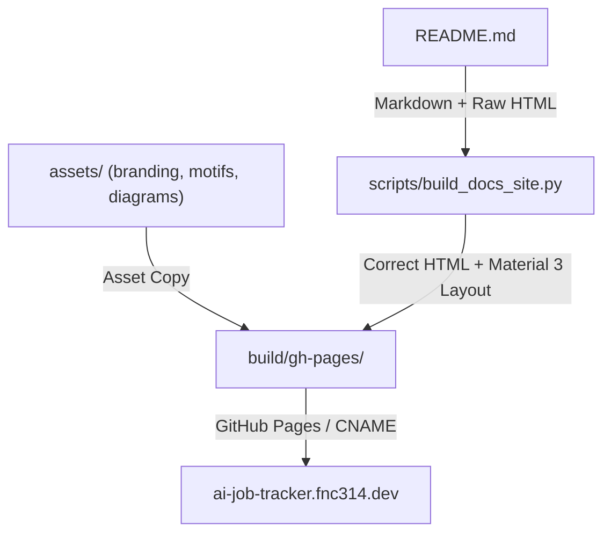

# Implementation Plan: Fix Documentation Site Markdown & Asset Rendering

**Status:** Completed  
**Date:** 2026-11-24  
**Target:** repository-wide  
**Harness:** Antigravity  
**Model:** gemini-2.5-pro  
**Session:** c3a5beb9-c626-4f40-bfe0-df9bfd9fead1  
**Schema Authority:** [`tracker.schema.json`](../../tracker.schema.json)  
**Depends On:** [`181134_public-documentation-pages-and-release-plan.md`](../2026-11-15/181134_public-documentation-pages-and-release-plan.md)  

---

## 1. Executive Summary & Goals

On the public documentation site at `https://ai-job-tracker.fnc314.dev/readme/index.html`, several rendering defects occur:

1. **Raw HTML escaping at top of page**: `<p align="center">` and `` from the root `README.md` are HTML-escaped into `<p>&lt;p align=&quot;center&quot;&gt;</p>` and rendered as plain text instead of showing the centered logo.
2. **Broken Image / Badge Links**: Markdown image badges (e.g. `[](...url)`) fail regex parsing and render as broken text links (``).
3. **Missing `assets/` directory in doc site**: Even if the `` tag is rendered as HTML, `assets/branding/brand_logo.svg` is not copied to the public output site (`build/gh-pages/assets/`), resulting in broken image references.
4. **Underscore italics**: Words surrounded by underscores (e.g. `_The job search platform..._`) are not converted to italics.

### Goals

- [ ] Upgrade `scripts/build_docs_site.py` markdown parser:
  - Support raw / block HTML elements (allow `<p align="center">`, ``, `</p>` without escaping).
  - Copy `assets/` directory (specifically `assets/branding/`) to the documentation site build output so relative image paths resolve properly.
  - Parse image links `` and nested link badges `[](target_url)` into valid HTML `<a></a>`.
  - Parse underscore italics `_text_` in addition to asterisks `*text*`.
- [ ] Verify clean generation of `build/gh-pages/readme/index.html` locally.

---

## 2. Architecture & Design Principles



### Parser Fix Details

1. **Pass-through HTML tags**: When a line in Markdown contains valid block or inline HTML (`<p ...>`, ``, `</p>`, etc.), do not wrap in `<p>` and do not escape `<` and `>` into `&lt;` and `&gt;`.
2. **Image and Badge parsing in `format_inline_markdown`**:

   ```python
   # 1. Linked images: [](link_url)
   text = re.sub(
       r'\[!\[([^\]]*)\]\(([^)]+)\)\]\(([^)]+)\)',
       r'<a href="\3"></a>',
       text
   )
   # 2. Standalone images: 
   text = re.sub(
       r'!\[([^\]]*)\]\(([^)]+)\)',
       r'',
       text
   )
   # 3. Standard links: [text](url)
   text = re.sub(
       r'\[([^\]]+)\]\(([^)]+)\)',
       r'<a href="\2">\1</a>',
       text
   )
   # 4. Italics: *text* and _text_
   text = re.sub(r'(?<!\w)_([^_]+)_(?!\w)', r'<em>\1</em>', text)
   ```

3. **Asset copy in `build_site`**:

   ```python
   assets_src = repo_root / "assets"
   if assets_src.exists():
       shutil.copytree(assets_src, output_dir / "assets", dirs_exist_ok=True)
   ```

---

## 3. Proposed Changes & Implementation Steps

### `scripts/build_docs_site.py`

#### [MODIFY] `scripts/build_docs_site.py`

- Update `format_inline_markdown(text: str)`:
  - Add regex handlers for `[](link)` and ``.
  - Add regex handlers for `_italic_`.
- Update `convert_markdown_to_simple_html(markdown_text: str)`:
  - Detect raw HTML lines (e.g. `<p align="center">`, `</p>`, `<div>`, etc.) and output them verbatim without `<p>&lt;...&gt;</p>` escaping.
- Update `build_site(output_dir: Path, domain: str)`:
  - Copy `assets/` to `output_dir / "assets"` so relative image links work across all pages.

---

## 4. Verification Plan & Testing Checklist

### Automated / Local Test

```bash
python3 scripts/build_docs_site.py --output /tmp/test-docs-build
```

1. Verify `/tmp/test-docs-build/assets/branding/brand_logo.svg` exists.
2. Check `/tmp/test-docs-build/readme/index.html`:
   - Contains `<p align="center">` and `</a>` instead of raw markdown.
   - Contains `<em>The job search platform that runs entirely on your machine.</em>`.

---

## 5. Bookkeeping

- [x] Plan persisted at `.agents/plans/2026-11-24/013453_fix-docs-site-markdown-rendering.md`
- [x] Registry `README.md` row added / status synchronized
- [ ] Push to `origin main` is reserved for user
