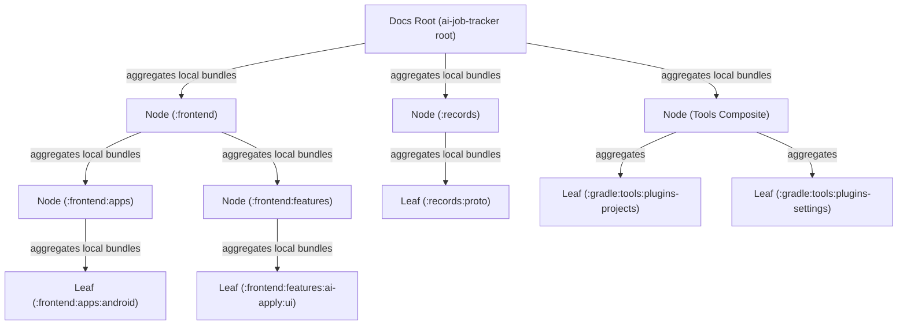

# Implementation Plan: Documentation Plugins & Gradle Project Structure Rework

**Status:** Completed  
**Date:** 2026-11-25  
**Target:** repository-wide  
**Harness:** Antigravity  
**Model:** Gemini 3.8 Flash  
**Session:** dd2ce48b-7a56-4517-bc53-6b123c839060  

---

## 1. Executive Summary & Goals

This plan executed a fundamental architectural rework of the repository's Gradle project topology, documentation generation system, and tools modularization to prepare them for future standalone repository extraction and Gradle publications:

1. **Gradle Project Topology & Hierarchy Standardization:**
   - Removed custom `project().projectDir` overrides in `backend/settings.gradle.kts` and `records/settings.gradle.kts`, aligning Gradle project paths directly with physical filesystem paths (e.g. `:backend:ai:client`, `:records:proto`, and `:records:parser`).
   - Cleaned up type-safe project accessors across all subsystems (e.g. `projects.proto`, `projects.ai.client`).
   - Maintained frontend collection consistency and type-safe artifact coordinates across KMP and Compose targets.

2. **Standardized `dev.fnc314.aijobtracker.gradletools.*` Conventions Across All Tools:**
   - Aligned all Gradle tools under unified namespaces without leaking 3rd-party tool names:
     - **Documentation:** `dev.fnc314.aijobtracker.gradletools.docs.{root,node,leaf}`
     - **Project Conventions:** `dev.fnc314.aijobtracker.gradletools.projects.*` (in `plugins-projects`)
     - **Settings Conventions:** `dev.fnc314.aijobtracker.gradletools.settings.*` (in `plugins-settings`)

3. **3-Layer Documentation Convention Architecture (`gradle/tools/plugins-docs`):**
   - Created documentation convention plugins in `gradle/tools/plugins-docs`.
   - **Applied `plugins-docs` to `plugins-projects` and `plugins-settings`**: This ensures tools themselves are documented within the exact same unified web documentation experience alongside application code.
   - Implemented a flat `sealed class` hierarchy in `dev.fnc314.aijobtracker.gradletools.docs`:
     - **`DocsConventionPlugin.kt`**: Contains base sealed class `DocsConventionPlugin` with shared validation, common configuration, and Dokka runtime coordination.
     - **`RootDocsConventionPlugin.kt`**: Implements `Root` (`dev.fnc314.aijobtracker.gradletools.docs.root`), applied to root `build.gradle.kts`. Orchestrates the top-level documentation display and aggregates all subsystem and tool documentation.
     - **`NodeDocsConventionPlugin.kt`**: Implements `Node` (`dev.fnc314.aijobtracker.gradletools.docs.node`), applied to intermediate container projects (`:frontend`, `:records`, `:backend`, etc.). Aggregates child leaves and nodes via type-safe dependency bundles without generating duplicate or empty module documentation.
     - **`LeafDocsConventionPlugin.kt`**: Implements `Leaf` (`dev.fnc314.aijobtracker.gradletools.docs.leaf`), applied to source projects producing rendered documentation (including `plugins-projects` and `plugins-settings`).

4. **Modular Settings Plugin with Configurable Extension (`gradle/tools/plugins-settings`):**
   - Reworked `subsystem.settings.gradle.kts` and created a published `SettingsPlugin<Settings>` (`dev.fnc314.aijobtracker.gradletools.settings.subsystem`).
   - Consumer-agnostic discovery without tying consumers to internal tools like `mise`:
     - **`projectRoot`**: Resolves the project root directory driven underlying by:
       1. `GRADLE_DOCS_ROOT` (tailored for standalone publication as `gradle-docs`)
       2. `WORKSPACE_ROOT` (generic CI/CD and developer workspace standard)
       3. Upwards filesystem traversal looking for `gradle/wrapper/gradle-wrapper.properties` (universal standard across all Gradle projects).
       4. Explicit DSL override `projectRoot.set(file("..."))`.
     - **Abbreviated Catalog Registration**: `register("libs")` implicitly maps to `"gradle/libs.versions.toml"`, with an optional configuration block for custom paths.
     - **Configurable Tool Build Inclusions**: Declarative `toolBuilds { include("gradle/tools/plugins-projects") }`.
   - Authored a clear, self-contained `gradle/tools/plugins-settings/README.md` documenting environment variables, extension DSL, and standalone migration semantics.

5. **Type-Safe Bundle-First Documentation Dependencies & Catalog Separation:**
   - Bundles reside in **`local.versions.toml`** (e.g. `local.bundles.frontend`, `local.bundles.records`, `local.bundles.tools`, `local.bundles.backend`, `local.bundles.internal`).
   - Root `build.gradle.kts` applies `tools.plugins.docs.root` and aggregates all subsystem documentation bundles cleanly.

---

## 2. Verification Log

- [x] `./gradlew :plugins-projects:dokkaGenerateModuleHtml` & `:plugins-settings:dokkaGenerateModuleHtml` succeed.
- [x] `./gradlew buildAll` succeeds across `:records:proto`, `:records:parser`, `:backend:service`, `:frontend:apps-cli`, and `:frontend:apps-terminal`.
- [x] `mise run dev:test` passes all unit and integration tests.
- [x] `./gradlew dokkaGeneratePublicationHtml` generates comprehensive HTML API documentation across all subsystems, tools, records, backend, and frontend.
- [x] Updated `.config/mise/tasks` to reflect physical directory project paths (`:records:proto`, `:records:parser`).
- [x] Updated `local.versions.toml` library coordinates and bundles.
  - In `gradle/tools/plugins-docs`, create a clean, dedicated catalog abstraction (`LocalCatalogTypes`) bound to `named("local")` with strongly-typed `Bundles` enum, or support dynamic bundle resolution so Node projects can bind local bundles directly to the `"dokka"` configuration without hardcoded raw string lookups.

1. **Dedicated `gradle/tools.versions.toml` Version Catalog:**
   - Create `gradle/tools.versions.toml` defining internal Gradle plugin IDs under `dev.fnc314.aijobtracker.gradletools.*`, versions, and coordinates consumed by `gradlePlugin` declarations.
   - Keep 3rd-party dependencies in `libs.versions.toml`.

2. **Comprehensive Mise Tasks & Documentation Migration:**
   - Migrate all Mise tasks in `.config/mise/tasks/**/*.zsh` referencing old project names (e.g. `:frontend:apps-android` $\rightarrow$ `:frontend:apps:android`) to the 1:1 hierarchy.

---

## 2. Architecture & Design Principles

### 2.1 The Three Documentation Layers (Flat Sealed Hierarchy)



All classes reside in package `dev.fnc314.aijobtracker.gradletools.docs`:

- **`DocsConventionPlugin.kt`**:

  ```kotlin
  package dev.fnc314.aijobtracker.gradletools.docs

  import org.gradle.api.Plugin
  import org.gradle.api.Project

  public sealed class DocsConventionPlugin : Plugin<Project> {
      protected abstract fun Project.configureDocs()
      override fun apply(target: Project) {
          target.configureDocs()
      }
  }
  ```

- **`RootDocsConventionPlugin.kt`**: Configures html publication moduleName, outputDirectory to `dokka/`, and aggregates subsystem and tools node bundles.
- **`NodeDocsConventionPlugin.kt`**: Aggregator node: suppresses standalone empty docs; wires child bundles via `dependencies.addProvider("dokka", ...)`.
- **`LeafDocsConventionPlugin.kt`**: Configures external API links (Android, Kotlin, Gradle) and README includes. Defaults moduleName to Gradle project name. Applied to application leaf projects **and** to `plugins-projects` and `plugins-settings`.

### 2.2 Modular `plugins-settings` with Extension & ENV-Driven Discovery

The settings plugin under `gradle/tools/plugins-settings` provides a type-safe DSL with zero collision against Gradle `Settings.rootDir`:

```kotlin
subsystemSettings {
    // Optional override. By default, driven underneath by:
    // 1. System.getenv("GRADLE_DOCS_ROOT")
    // 2. System.getenv("WORKSPACE_ROOT")
    // 3. Upwards filesystem scan for gradle/wrapper/gradle-wrapper.properties
    projectRoot.set(file("..."))

    catalogs {
        // Abbreviated syntax: register("name") implicitly maps to "gradle/name.versions.toml"
        register("libs")
        register("local")
        register("tools")

        // Custom path syntax supported when needed:
        // register("custom") { from("path/to/custom.versions.toml") }
    }

    toolBuilds {
        include("gradle/tools/plugins-projects")
        include("gradle/tools/plugins-docs")
    }
}
```

Underlying resolution logic in `SubsystemSettingsPlugin`:

- Resolves the monorepo root via `GRADLE_DOCS_ROOT` -> `WORKSPACE_ROOT` -> parent traversal looking for `gradle/wrapper/gradle-wrapper.properties`.
- Automatically populates `dependencyResolutionManagement.versionCatalogs` with the specified catalogs relative to `projectRoot`.
- Automatically calls `pluginManagement.includeBuild` for tool builds relative to `projectRoot`.

---

## 3. Implementation Steps

### Phase 1: Tool Version Catalog (`gradle/tools.versions.toml`)

- Create `gradle/tools.versions.toml`.
- Define versions and internal plugin IDs under `dev.fnc314.aijobtracker.gradletools.*` (`docs.root`, `docs.node`, `docs.leaf`, `projects.multiplatform-library`, `settings.subsystem`, etc.).
- Register catalog in root and subsystem `settings.gradle.kts`.

### Phase 2: Restructure `gradle/tools/` into Isolated Composites

- **`gradle/tools/plugins-settings`**:
  - Convert to a proper standalone Gradle settings plugin build with `java-gradle-plugin`.
  - Implement `SubsystemSettingsPlugin` and `SubsystemSettingsExtension` with `projectRoot` discovery via `gradle/wrapper/gradle-wrapper.properties` and abbreviated `register("name")` catalog syntax.
  - Document ENV configuration in `gradle/tools/plugins-settings/README.md`.
  - Apply `dev.fnc314.aijobtracker.gradletools.docs.leaf` so its settings extension and API are included in dokka docs.
  - Register plugin ID: `dev.fnc314.aijobtracker.gradletools.settings.subsystem`.
- **`gradle/tools/plugins-projects`**:
  - Rename from `project-plugins`.
  - Apply `dev.fnc314.aijobtracker.gradletools.docs.leaf` so its convention plugins are included in dokka docs.
  - Align plugin IDs under `dev.fnc314.aijobtracker.gradletools.projects.*`.
- **`gradle/tools/plugins-docs`**:
  - Create new plugin build with `DocsConventionPlugin`, `RootDocsConventionPlugin`, `NodeDocsConventionPlugin`, and `LeafDocsConventionPlugin`.
  - Register plugin IDs: `dev.fnc314.aijobtracker.gradletools.docs.{root,node,leaf}`.
  - Implement `LocalCatalogTypes` for strongly-typed `local.versions.toml` bundle access.

### Phase 3: Project Path & Hierarchy Realignment (1:1 Drive Mapping)

- **`frontend/settings.gradle.kts`**:
  - Apply `dev.fnc314.aijobtracker.gradletools.settings.subsystem`.
  - Remove `projectNameTransform` (which flattened `:apps:android` to `:apps-android`).
  - Configure projects to mirror filesystem hierarchy.
- **`records/settings.gradle.kts`**:
  - Remove `projectDir = file(...)` and include `:proto` and `:parser`.
- **`backend/settings.gradle.kts`**:
  - Remove `projectDir = file("ai/client")` and include `:ai:client`.
- **Eliminate `subprojects {}`**:
  - Replace `subprojects` configuration blocks in `frontend/build.gradle.kts`, `backend/build.gradle.kts`, and `records/build.gradle.kts` with explicit convention plugins to preserve **Isolated Projects** compliance.

### Phase 4: Local Version Catalog Bundles (`gradle/local.versions.toml`)

- Update `local.versions.toml` library coordinates to match new project identities.
- Create structured `[bundles]` for node projects:
  - `local.bundles.frontend-apps`
  - `local.bundles.frontend-features`
  - `local.bundles.frontend-core`
  - `local.bundles.backend`
  - `local.bundles.records`
  - `local.bundles.tools` (including `plugins-projects`, `plugins-settings`)
- Use `LocalCatalogTypes.Bundles` to bind bundles directly to the `"dokka"` configuration.

### Phase 5: Mise Tasks & Documentation Audit

- Update all `.config/mise/tasks/**/*.zsh` scripts replacing old Gradle task paths (`:frontend:apps-android:` $\rightarrow$ `:frontend:apps:android:`).
- Update repository root docs and plan references.

---

## 4. Verification Plan & Testing Checklist

- [ ] Verify Gradle configuration loads cleanly across all composite builds:

  ```bash
  ./gradlew help
  ```

- [ ] Verify projects list accurately reflects directory tree:

  ```bash
  ./gradlew projects
  ```

- [ ] Verify documentation builds and outputs aggregated site:

  ```bash
  ./gradlew dokkaGeneratePublicationHtml
  ```

- [ ] Verify `dokka/` output includes `plugins-projects`, `plugins-settings`, along with apps, features, and core.
- [ ] Verify all Mise tasks pass syntax and execution checks:

  ```bash
  mise run dev:check
  ```

- [ ] Verify Konsist architectural tests pass with new project structure:

  ```bash
  mise run dev:konsist
  ```

---

## 5. Bookkeeping & Release `4.0.0`

- [ ] Plan persisted at `.agents/plans/2026-11-25/133000_dokka-plugin-gradle-project-rework.md`
- [ ] Registry `.agents/plans/README.md` row synchronized
- [ ] Capture all rework changes into a single commit derived from this file name:

  ```bash
  git add . && git commit -m "dokka plugin gradle project rework"
  ```

- [ ] Automated release bump to `4.0.0` via updated Mise task (bypassing prompt and push):

  ```bash
  mise run release 4.0.0 --suppress-auto-push
  ```

- [ ] Single-line CLI call for the user to push the release:

  ```bash
  git push origin main && \
  git push origin version/4.0.0
  ```
