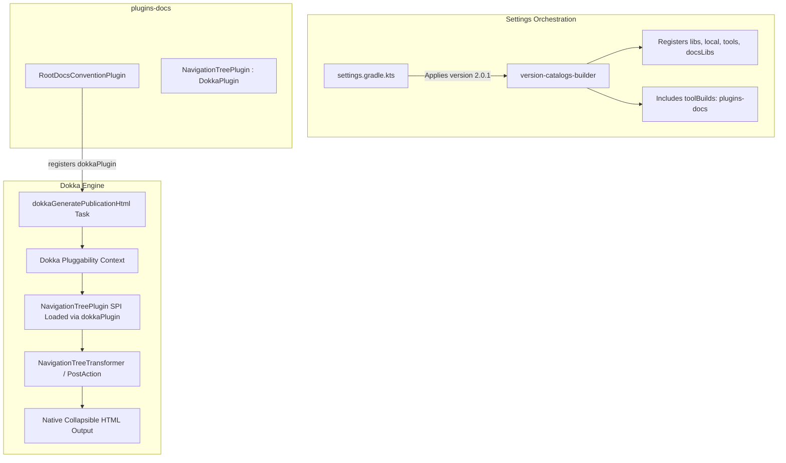

# Implementation Plan: Native Navigation Tree Plugin & Settings Plugin Modernization

**Status:** Completed  
**Date:** 2026-11-25  
**Target:** repository-wide  
**Harness:** Antigravity  
**Model:** gemini-3.8-flash  
**Session:** dd2ce48b-7a56-4517-bc53-6b123c839060  

---

## 1. Executive Summary & Goals

Design and implement a native Dokka Plugin (implementing `org.jetbrains.dokka.plugability.DokkaPlugin`) housed directly inside `gradle/tools/plugins-docs`. It will be named neutrally as `NavigationTreePlugin`, obscuring the direct Dokka naming in its class name, while natively transforming Dokka's multi-module navigation into a collapsible, hierarchical tree.

Additionally, this plan modernizes settings plugin orchestration by migrating to **`version-catalogs-builder-gradle-settings-plugin` version `2.0.3`** (`dev.fnc314.gradle.plugins.settings.version-catalogs-builder-gradle-settings-plugin`), housing internal Dokka dependencies in a local version catalog (`gradle/tools/plugins-docs/gradle/libs.versions.toml`), and ensures all empty directories across the repository are thoroughly identified and removed.

---

## 2. Architecture & Design Principles



### 1. Dedicated Version Catalog for `plugins-docs`

In `gradle/tools/plugins-docs/gradle/libs.versions.toml`:

```toml
[versions]
dokka = "2.3.0"

[libraries]
dokka-core = { module = "org.jetbrains.dokka:dokka-core", version.ref = "dokka" }
dokka-base = { module = "org.jetbrains.dokka:dokka-base", version.ref = "dokka" }
```

### 2. Dependency Wiring in `plugins-docs/build.gradle.kts`

```kotlin
dependencies {
  compileOnly(gradleApi())
  api(libs.dokka.gradle.plugin)
  compileOnly(docsLibs.dokka.core)
  compileOnly(docsLibs.dokka.base)
}
```

---

## 3. Proposed Changes & Implementation Steps

### Settings & Catalogs Modernization

#### [NEW] `gradle/tools/plugins-docs/gradle/libs.versions.toml`

- Declare `dokka-core` and `dokka-base` (and local Dokka dependencies) isolated to `plugins-docs`.

#### [MODIFY] `gradle/libs.versions.toml`

- Prune unnecessary Dokka library declarations from root catalog now that Dokka plugin internal dependencies are isolated to `gradle/tools/plugins-docs/gradle/libs.versions.toml` and convention plugins.

#### [MODIFY] `gradle/tools/settings-plugins/subsystem.settings.gradle.kts`

- Apply `dev.fnc314.gradle.plugins.settings.version-catalogs-builder-gradle-settings-plugin` at version `2.0.1`.
- Replace manual repository and catalog wiring with declarative `versionCatalogsBuilder { ... }`.

#### [MODIFY] `gradle/tools/plugins-docs/settings.gradle.kts`

- Apply `version-catalogs-builder-gradle-settings-plugin` at `2.0.1` to register catalogs (`libs`, `local`, `tools`, `docsLibs`).

### `gradle/tools/plugins-docs`

#### [MODIFY] `gradle/tools/plugins-docs/build.gradle.kts`

- Add `compileOnly(docsLibs.dokka.core)` and `compileOnly(docsLibs.dokka.base)`.

#### [NEW] `gradle/tools/plugins-docs/src/main/kotlin/dev/fnc314/aijobtracker/gradletools/docs/tree/NavigationTreePlugin.kt`

- Implements `DokkaPlugin`.
- Declares the extension points and tree transformation pipeline.
- Name does not mention "Dokka" directly, adhering to the official SPI contract.

#### [NEW] `gradle/tools/plugins-docs/src/main/resources/META-INF/services/org.jetbrains.dokka.plugability.DokkaPlugin`

- Registers `dev.fnc314.aijobtracker.gradletools.docs.tree.NavigationTreePlugin`.

#### [MODIFY] `gradle/tools/plugins-docs/src/main/kotlin/dev/fnc314/aijobtracker/gradletools/docs/RootDocsConventionPlugin.kt`

- Remove the `organizeDokkaNavigation` `Exec` task.
- Configure `dokkaPlugin` dependency on the `plugins-docs` project.

### Pruning & Cleanup

#### [DELETE] `.config/mise/tasks/docs/scripts/organize-dokka-tree.py`

- Remove Python script and any empty parent directories (`.config/mise/tasks/docs/scripts`).

#### [DELETE] Empty Directories

- Run automated pruning across the repository to ensure zero empty directories remain.

---

## 4. Verification Plan & Testing Checklist

### Automated Tests & Builds

1. `./gradlew :plugins-docs:compileKotlin` to verify type-safe `docsLibs` accessors and compilation.
2. `./gradlew :dokkaGenerateHtml` to verify that Dokka runs with `NavigationTreePlugin` loaded via SPI.
3. Verify that `dokka/navigation.html` and `dokka/index.html` render the hierarchical collapsible structure.
4. Run `find . -type d -empty -not -path "./.git/*"` to verify zero empty directories exist in the workspace.

---

## 5. Bookkeeping

- [x] Plan persisted at `.agents/plans/2026-11-25/190109_native-navigation-tree-plugin-and-settings-plugin-modernization.md`
- [x] Registry `README.md` row added / status synchronized
- [ ] Craft a single commit of all changed files
- [ ] Stage changed files and craft a commit message based on the name of this file
- [ ] Push `git push origin main`
