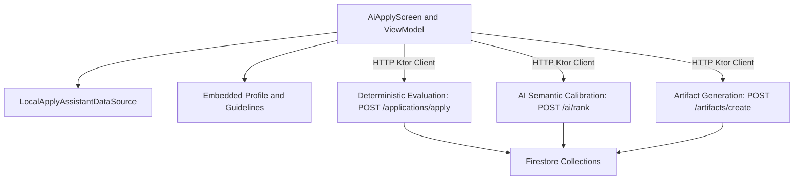

# Architecture Plan: AI Apply Pipeline Isolation & Agent Configuration Embedding

**Status:** Completed  
**Date:** 2026-11-23  
**Target:** frontend  
**Harness:** Antigravity  
**Model:** Gemini 3.8 Flash  
**Session:** d78db87b-e36f-4141-a06f-73efa520110f  

---

## 1. Executive Summary & Goals

This plan evaluates and documents:

1. **Root-Cause Architectural Assessment:** Why integrating Firebase AI (client-side Gemini/Vertex AI SDK) directly inside `frontend/features/ai-apply` is **architecturally incorrect**, insecure, and violates multiplatform constraints.
2. **Configuration Embedding Analysis:** Determining whether and how `.agents/` configurations (candidate profiles, evaluation guidelines, command specs, and LaTeX templates) can be embedded and utilized within `frontend/apps` across multiplatform targets (Android, Desktop, iOS, Web).
3. **Target System Topology:** Formalizing the clean separation between client-side user experience (Compose Multiplatform), embedded static prompt/profile contracts, and secure backend orchestration (TeX Live compilation, model inference, and event chaining).

---

## 2. Architecture & Design Principles

### 2.1 Why Firebase AI is NOT Correct for `frontend/features/ai-apply`

Firebase AI (Firebase Vertex AI / Firebase AI Logic) provides client-side SDK bindings for direct Gemini model invocation. Incorporating this directly into `frontend/features/ai-apply` introduces severe architectural defects:

1. **Untrusted Client Boundary & Prompt Exfiltration:**
   - The job application flow requires proprietary, private candidate data: complete candidate profile, verified work history, compensation boundaries, deal-breakers, and LaTeX compilation instructions (`.agents/skills/job-application-assistant/01-candidate-profile.md`, `02-behavioral-profile.md`, etc.).
   - Client-side invocation forces private prompts and rules to live inside client memory or configuration, making them subject to decompilation, reverse engineering, and extraction.
2. **Native Tooling & Compilation Dependency (TeX Live, LaTeXmk, PDF):**
   - The Apply Assistant flow is not a text chatbot; its core goal is progressing an application from `RANKED` $\rightarrow$ `DRAFTING` $\rightarrow$ `DRAFTED` $\rightarrow$ `SUBMITTED`, generating compiled PDF artifacts (`main_example.tex`, `cover.cls`).
   - Mobile and Web runtimes (iOS sandbox, Android sandbox, WebAssembly/JS) cannot run native compilers (`lualatex`, `pdflatex`, `xelatex`, `latexmk`, `pdftotext`). Artifact generation is strictly a backend workload running in Cloud Run with a full TeX Live distribution.
3. **KMP (Kotlin Multiplatform) Tier Support Fragmentation:**
   - `frontend/features/ai-apply` targets Android, Desktop JVM, iOS, and Web (JS / WasmJS).
   - The Firebase AI SDK does not have unified first-class Kotlin Multiplatform support across JVM Desktop and WebAssembly. Using backend HTTP endpoints (`POST /applications/apply`, `POST /ai/rank`, `POST /artifacts/create`) preserves 100% pure KMP code across all five client targets.
4. **Dual-Tier State Machine Integrity:**
   - The workflow relies on **Tier 1 deterministic scoring** (`RankScorer.evaluate()`, zero-cost, instant `<1s`) followed optionally by **Tier 2 AI calibration** (`/ai/rank`).
   - Bypassing the backend would fragment state machine transitions and break centralized event chaining and Firestore synchronization.



### 2.2 Feasibility of Embedding `.agents` Configurations into `frontend/apps`

The contents of `.agents/` encompass:

- **Candidate Knowledge Base:** Profile, behavioral traits, style guidelines, job evaluation matrices (`01-candidate-profile.md` through `08-application-forms.md`).
- **Command Specifications:** Workflow steps (`apply.md`, `rank.md`, `scrape.md`).
- **External Skills & CLIs:** Python/Node scraping tools (`linkedin-search`, `freehire-search`, `composio`).

#### Permissible Embedding (What Can Be Embedded)

- **Candidate Profile & Templates as Static Resources:** The Markdown/JSON guidelines from `job-application-assistant` can be bundled into `frontend/apps/core` or `frontend/core/resources` via Compose Multiplatform Resources (`composeResources`). This powers offline preview, in-app inspection of profile rules, and deterministic local fallback evaluation.
- **Workflow / Command Schemas:** Declarative prompt definitions can be embedded for UI inspection, prompt debugging, and transparent display of AI instructions.

#### Non-Permissible Embedding (What Must Remain External/Backend)

- **Autonomous CLI Agents & Subprocesses:** Skills that spawn Python scripts, Mise tasks, headless browsers, or shell pipelines cannot execute inside sandboxed iOS, Android, or WebAssembly client apps.
- **Secret Credentials & Model Tokens:** API keys (Gemini, LinkedIn session tokens, Hunter.io, Composio) must not be bundled in frontend binaries.

---

## 3. Proposed Changes & Implementation Steps

### Phase 1: Formalize Architectural Boundaries in Documentation

- Update `frontend/features/ai-apply/README.md` to explicitly state why backend orchestration is mandatory and why client-side Firebase AI SDK is rejected.
- Clarify the role of the Dual-Tier architecture (`RankScorer` deterministic baseline vs. Cloud AI refinement).

### Phase 2: Package Candidate Profile & Rules as Multiplatform Resources (Optional / Future Slice)

- Create a build task or Gradle sync step to generate or synchronize read-only candidate profile assets from `.agents/skills/job-application-assistant/` into `frontend/apps/core/src/commonMain/composeResources/files/`.
- Expose a domain interface `CandidateProfileProvider` in `frontend/core/data` to load and inspect profile guidelines in the client UI.

### Phase 3: Maintain Ktor Remote Endpoints for All Inference & Compilation

- Keep `NetworkApplyAssistantDataSourceImpl` calling:
  - `POST /applications/apply` (Tier 1 deterministic)
  - `POST /ai/rank` (Tier 2 AI refinement)
  - `POST /artifacts/create` and `GET /artifacts/jobs/{jobId}` (asynchronous TeX compilation)

---

## 4. Verification Plan & Testing Checklist

- [x] Confirm no direct Firebase Vertex AI / Firebase AI SDK dependencies exist in `frontend/features/ai-apply/` or `frontend/apps/`.
- [x] Verify `features-ai-apply-domain`, `features-ai-apply-data`, and `features-ai-apply-ui` compile and pass tests across JVM and Android:

  ```bash
  ./gradlew -p frontend :features-ai-apply-domain:jvmTest :features-ai-apply-data:jvmTest :features-ai-apply-ui:jvmTest
  ```

- [x] Confirm clean separation between client-side Ktor endpoints and backend Cloud Run TeX Live / AI pipeline.
- [x] Updated architectural documentation in `frontend/features/ai-apply/README.md`.

---

## 5. Bookkeeping

- [x] Plan persisted at `frontend/.agents/plans/2026-11-23/112000_ai-apply-pipeline-isolation-and-agent-embedding-plan.md`
- [x] Registry `frontend/.agents/plans/README.md` row added / status synchronized
- [x] Capture all changed files into a single commit whose message is derived from this file name
