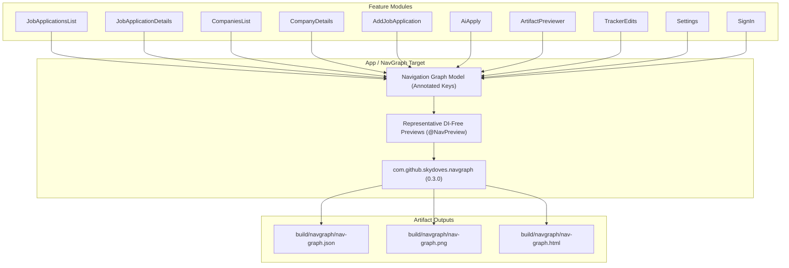

# Implementation Plan: Compose Navigation Graph (`compose-nav-graph`) Integration

**Status:** In Progress  
**Date:** 2026-11-24  
**Target:** `:frontend:apps:android`  
**Harness:** Antigravity  
**Model:** gemini-2.5-pro  
**Session:** c3a5beb9-c626-4f40-bfe0-df9bfd9fead1  
**Guide Authority:** [`plugin-agent-guides.md`](https://github.com/skydoves/compose-nav-graph/blob/main/plugin-agent-guides.md)  

---

## 1. Executive Summary & Goals

Integrate the [`com.github.skydoves.navgraph`](https://github.com/skydoves/compose-nav-graph) Gradle plugin into the project according to the official [Plugin Agent Guide](https://github.com/skydoves/compose-nav-graph/blob/main/plugin-agent-guides.md).

This will allow our multiplatform and Android application to automatically generate:

1. `build/navgraph/nav-graph.json`: structured navigation model (destinations, arguments, transitions, preview metadata).
2. `build/navgraph/nav-graph.png`: static visual hierarchy graph with real rendered previews.
3. `build/navgraph/nav-graph.html`: interactive visual navigation graph with embedded base64 thumbnails and interactive node exploration.

---

## 2. Architecture & Design Principles

### The Representative Preview Rule (Section 6)

Real composable screens in our application rely on Koin dependency injection (`koinViewModel()`), reactive flows, and Firebase/Firestore repositories. During headless rendering (Layoutlib or Robolectric), DI containers are not initialized.

Following Section 6 of the playbook, we implement representative previews:

- Zero DI, zero ViewModels, zero network calls.
- Deterministic `AppPreviewTheme` wrapped around realistic layouts mimicking each destination.
- Stubs use design tokens matching our Material 3 theme.

---

## 3. Implementation Steps

### A. Dependency Setup

1. In `gradle/libs.versions.toml`:
   - Declare version `navgraph = "0.3.0"`.
   - Declare plugin `navgraph = { id = "com.github.skydoves.navgraph", version.ref = "navgraph" }`.
   - Declare library `compose-navgraph-annotations = { module = "com.github.skydoves.navgraph:annotations", version.ref = "navgraph" }`.

### B. Module Configuration

2. In `frontend/apps/android/build.gradle.kts`:
   - Apply `alias(libs.plugins.ksp)`.
   - Apply `alias(libs.plugins.navgraph)`.
   - Configure `ksp { arg("navgraph.annotatedOnly", "true") }`.
   - Configure `navgraph { renderBackend.set(com.github.skydoves.navgraph.gradle.RenderBackend.AUTO) }`.

### C. Annotated Graph & Representative Previews

3. Create `frontend/apps/android/src/main/kotlin/dev/fnc314/aijobtracker/app/android/navgraph/AppNavGraph.kt`:
   - Annotate all destination keys with `@NavDestination` and `@NavEdge`.
   - Designate `JobApplicationListRoute` with `@NavGraphRoot`.
   - Implement `@NavPreview` functions for all 10 core destinations.

### D. Mise Automation Task

4. Add `.config/mise/tasks/frontend/navgraph.zsh` to generate the interactive HTML and PNG files with a single command (`mise run navgraph`).

---

## 4. Verification Plan

1. Run `./gradlew :frontend:apps:android:generateNavGraph :frontend:apps:android:exportNavGraphImage :frontend:apps:android:exportNavGraphHtml --console=plain`.
2. Inspect `build/navgraph/nav-graph.json` to verify node count and edges.
3. Verify `build/navgraph/nav-graph.png` and `build/navgraph/nav-graph.html` are created with rendered thumbnails.
