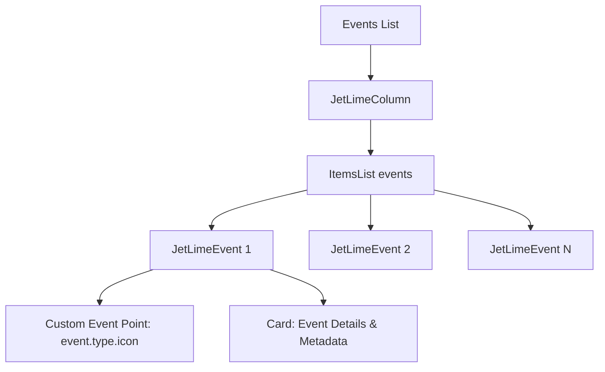

# Implementation Plan: JetLime Timeline Integration for Job Application Details

**Status:** Completed  
**Date:** 2026-11-25  
**Target:** `frontend` (`frontend:features:job-application-details:ui`)  
**Harness:** Antigravity  
**Model:** gemini-3.8-flash  
**Session:** dd2ce48b-7a56-4517-bc53-6b123c839060  

---

## 1. Executive Summary & Goals

The `frontend:features:job-application-details:ui` module currently renders job application event histories (`events: ImmutableList<TrackerEvent>`) using a custom `Grid`-based timeline implementation in `EventsTimeline.kt`. While functional, the custom implementation manually stitches top/bottom vertical connector bars and icon nodes using fixed grid track allocations.

This plan details the enhancement of `frontend:features:job-application-details:ui` by adopting [**JetLime**](https://github.com/pushpalroy/jetlime) (`io.github.pushpalroy:jetlime:4.3.0`), the leading open-source Kotlin Multiplatform timeline UI library for Compose Multiplatform indexed on [klibs.io](https://klibs.io).

### Research Findings & Ecosystem Alternatives

- **Pushpal Roy's JetLime (`io.github.pushpalroy:jetlime:4.3.0`)**:
  - The gold-standard and most widely adopted dedicated timeline library for Compose Multiplatform.
  - Native support for Android, iOS, Desktop (JVM), and Web (JS & WasmJs).
  - Out-of-the-box support for `JetLimeColumn`, line customization (solid, dashed, brush/gradients), point styling (`EMPTY`, `FILLED`, `CUSTOM`), and event positioning (`START`, `MIDDLE`, `END`).
- **Other klibs.io alternatives evaluated**:
  - `diagram` (`:diagram-layout`): Full diagramming engine (Mermaid/PlantUML syntax); over-engineered and heavyweight for in-app event history cards.
  - `element-plus-kmp` / `ant-design-kmp`: Full component suites; introducing them brings large foreign design-system paradigms that conflict with the app's Material 3 design system.
  - `Ganttastic`: Focused on Gantt charts and duration bars rather than discrete audit event nodes.
- **Conclusion:** JetLime is by far the most direct, focused, and tested library for milestone/event timelines in Compose Multiplatform.

---

## 2. Architecture & Design Principles

1. **Version Catalog Isolation:**
   - Define `jetlime = "4.3.0"` in `gradle/libs.versions.toml`.
   - Expose library declaration `jetlime = { module = "io.github.pushpalroy:jetlime", version.ref = "jetlime" }`.
2. **Design System Token Fidelity (Strict Rule Enforcement):**
   - Zero hardcoded literal values (`.dp`, `.sp`, raw `Color(...)`).
   - Line widths, point radiuses, and paddings must bind directly to `MaterialTheme.componentSizes.timelineLineWidth`, `MaterialTheme.componentSizes.timelineNodeSize`, and `MaterialTheme.spacing.*`.
   - Colors must pull from `MaterialTheme.colorScheme.primary`, `MaterialTheme.colorScheme.outlineVariant`, `MaterialTheme.colorScheme.primaryContainer`, etc.
3. **Multiplatform & Accessibility Compliance:**
   - Full support for JVM, Android, iOS, and Web (JS/WasmJS).
   - Retain semantic content descriptions on event rows for screen readers (`Res.string.timeline_event_cd`).
   - Retain interactive click handling (`onEventClick` / `EventDetailDialog`).
4. **Code Standards & KDoc:**
   - Maintain complete KDoc on all public/internal composables and models.
   - Use 2-space indentation matching root `.editorconfig`.

---

## 3. Proposed Changes & Implementation Steps

### A. Catalog & Dependencies

#### [MODIFY] `gradle/libs.versions.toml`

Add JetLime dependency coordinate:

```toml
[versions]
jetlime = "4.3.0"

[libraries]
jetlime = { module = "io.github.pushpalroy:jetlime", version.ref = "jetlime" }
```

#### [MODIFY] `frontend/features/job-application-details/ui/build.gradle.kts`

Add `implementation(libs.jetlime)` to `commonMain.dependencies`.

---

### B. UI Implementation

#### [MODIFY] `frontend/features/job-application-details/ui/src/commonMain/kotlin/dev/fnc314/aijobtracker/frontend/features/jobapplicationdetails/ui/component/EventsTimeline.kt`

- Replace manual `Grid` row calculations with `JetLimeColumn` and `JetLimeEvent`.
- Use `ItemsList(events)` with stable item keys (`event.id` or composite timestamp).
- Use `JetLimeEventDefaults.eventStyle` configured with:
  - `position`: automatically mapped from JetLime's scope.
  - `pointType`: `EventPointType.custom(icon = rememberVectorPainter(event.type.icon), tint = MaterialTheme.colorScheme.onPrimaryContainer)` or styled circular point with icon.
  - `pointColor`: `MaterialTheme.colorScheme.primaryContainer`.
  - `lineColor`: `MaterialTheme.colorScheme.outlineVariant`.
  - `lineThickness`: `MaterialTheme.componentSizes.timelineLineWidth`.
- Slot the existing event details card (`EventsTimelineDescription`) cleanly into `JetLimeEvent` content body.
- Retain `EventDetailDialog` invocation when clicking an event card.



---

## 4. Verification Plan & Testing Checklist

### Automated Checks

- Run Detekt linter:

  ```zsh
  ./gradlew :frontend:features:job-application-details:ui:detekt
  ```

- Run Konsist architectural rules:

  ```zsh
  ./gradlew :tests:test --tests "*Konsist*"
  ```

- Run unit tests:

  ```zsh
  ./gradlew :frontend:features:job-application-details:ui:allTests
  ```

- Verify module assemble across targets:

  ```zsh
  ./gradlew :frontend:features:job-application-details:ui:assemble
  ```

### Manual Verification

- Launch Desktop client or inspect UI preview to verify:
  1. Timeline connector lines connect seamlessly from top to bottom.
  2. Start and end nodes terminate cleanly without orphan overshoots.
  3. Clicking any event node or card opens the `EventDetailDialog` with full payload and metadata.
  4. Empty events list renders empty-state text as before.

---

## 5. Bookkeeping

- [ ] Plan persisted at `frontend/.agents/plans/2026-11-25/204022_jetlime-timeline-integration.md`
- [ ] Registered in `frontend/.agents/plans/README.md`
- [ ] Single atomic commit following conventional commits format
- [ ] Push to `origin main`
